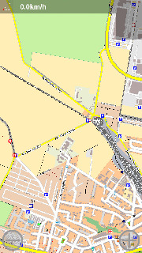
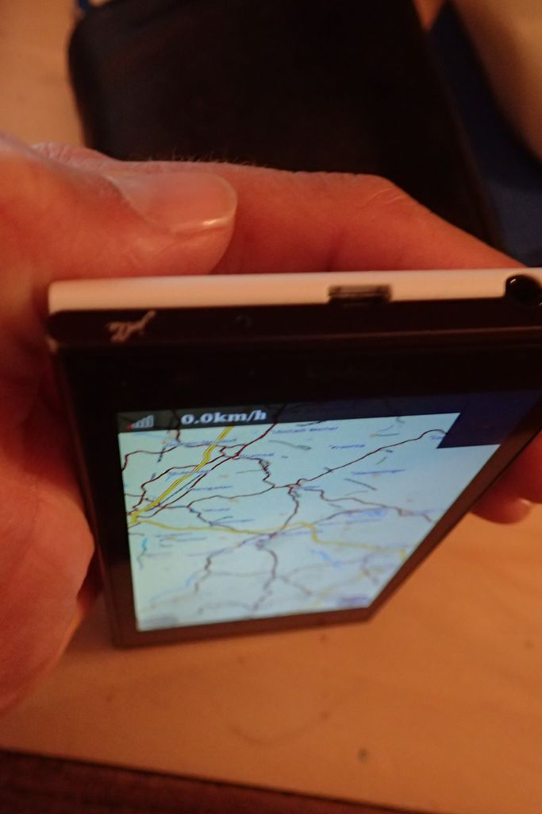
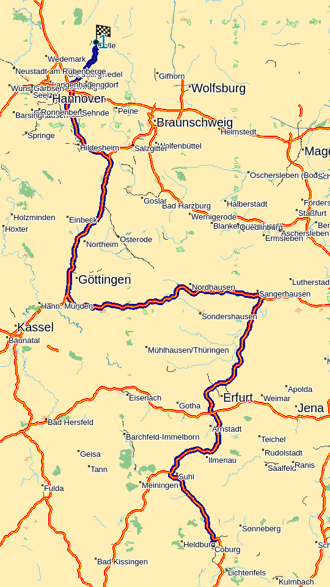
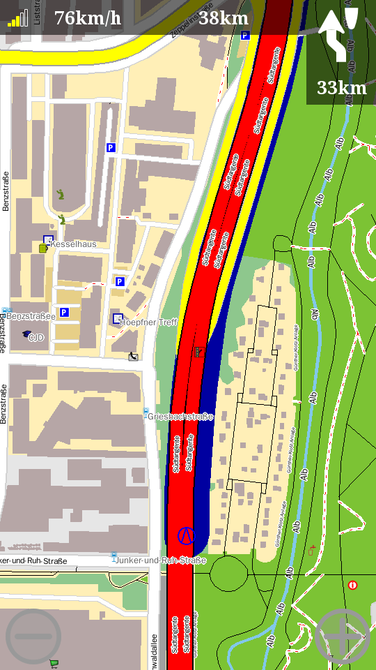
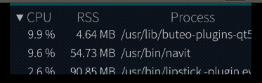

.. _sailfish_os:

Sailfish OS
===========

| **Status:** The app is tested and running on Sailfish OS on Jolla 1.
| This port is still in development stage and needs further testing.

The most up to date Sailfish OS package is provided in an external
repository. But you can also compile latest version easily with the
Sailfish SDK.

.. _installing_ready_compiled_navit_from_openrepos:

Installing ready compiled Navit from openrepos
----------------------------------------------

| https://openrepos.net/content/metalstrolch/navit
| You will find it also in the Warehouse application

.. _compiling_latest_version_from_github:

Compiling latest version from GitHub
------------------------------------

The build is tested on Ubuntu 24.04 LTS with the Sailfish OS Platform SDK
5.0.0.43. The `build workflow <https://github.com/navit-gps/navit/blob/trunk/.github/workflows/build.yml>`__
runs the SDK in the ``coderus/sailfishos-platform-sdk:5.0.0.43`` container and
calls `build_sailfish_ci.sh <https://github.com/navit-gps/navit/blob/trunk/contrib/sailfish/build_sailfish_ci.sh>`__.
It produces ``armv7hl`` and ``aarch64`` RPMs, which are uploaded as the
``Sailfish RPMs`` artifact.

To reproduce the CI build locally:

.. code:: console

   mkdir -p /tmp/rpmbuild && chmod 777 /tmp/rpmbuild
   docker run -e VERSION_ID=5.0.0.43 \
     -v "$PWD:/home/nemo/navit" \
     -v "/tmp/rpmbuild:/home/nemo/rpmbuild:rw" \
     coderus/sailfishos-platform-sdk:5.0.0.43 \
     /bin/bash -lxc "git config --global --add safe.directory /home/nemo/navit; /home/nemo/navit/contrib/sailfish/build_sailfish_ci.sh"

The resulting packages are written to ``/tmp/rpmbuild/RPMS/``.

.. _running_on_jolla_2.0.1.11:

Running on Jolla 2.0.1.11
-------------------------

.. _step_1___copy_the_rpm:

Step 1 - Copy the rpm
~~~~~~~~~~~~~~~~~~~~~

``scp rpmbuild/RPMS/armv7hl/harbour-navit-'builtversion'.armv7hl.rpm nemo@'IP of your device':``

.. _step_2___install_required_libs:

Step 2 - Install required LIBS
~~~~~~~~~~~~~~~~~~~~~~~~~~~~~~

pkcon install gettext

.. _step_3___install_as_root:

Step 3 - Install as root
~~~~~~~~~~~~~~~~~~~~~~~~

devel-su rpm -i harbour-navit-'builtversion'.armv7hl.rpm

.. _screenshots_and_pictures:

Screenshots and pictures
------------------------

Jolla
~~~~~

| Some screenshots with a SailfishOS-like OSD:
| `1 <https://github.com/zintor/navit-jolla-layout/blob/master/screenshots/calculating.png>`__
  `2 <https://github.com/zintor/navit-jolla-layout/blob/master/screenshots/no_destination.png>`__
  `3 <https://github.com/zintor/navit-jolla-layout/blob/master/screenshots/no_driving.png>`__
  `4 <https://github.com/zintor/navit-jolla-layout/blob/master/screenshots/output640.gif>`__

| Some screenshots with pre-shipped OSD:
| |Navit-sailfish-output320.jpg| |Jolla_map_withoutGPS_20161014.jpg|
  |Jolla_map2_withoutGPS_20161014.jpg| |Jolla_Routing_20161005.png|
  |Jolla_Navit_Ressourcen.png|

.. _jolla_harbour_validator:

Jolla Harbour Validator
-----------------------

These is the result of the Jolla Harbour Validator tool:

.. _package_name:

Package name
~~~~~~~~~~~~

``PASSED``

.. _rpm_file_name:

RPM file name
~~~~~~~~~~~~~

``PASSED``

.. _qml_files:

QML files
~~~~~~~~~

``PASSED``

.. _desktop_file:

Desktop file
~~~~~~~~~~~~

| ``WARNING [/usr/share/applications/harbour-navit.desktop] X-Nemo-Application-Type should be silica-qt5 (not a Silica app?)``
| ``PASSED``

Paths
~~~~~

| ``INFO [/usr/share/icons/hicolor/[0-9x]{5,9}/apps/harbour-navit.png] All needed icons found!``
| ``ERROR [/usr/share/man/man1/maptool.1.gz] Installation not allowed in this location``
| ``ERROR [/usr/share/man/man1/harbour-navit.1.gz] Installation not allowed in this location``
| ``FAILED``

Libraries
~~~~~~~~~

| ``WARNING [/usr/bin/harbour-navit] file is not stripped!``
| ``PASSED``

Icon
~~~~

``PASSED``

Symbols
~~~~~~~

``PASSED``

Permissions
~~~~~~~~~~~

``PASSED``

Scripts
~~~~~~~

``PASSED``

Provides
~~~~~~~~

``PASSED``

Obsoletes
~~~~~~~~~

``PASSED``

Requires
~~~~~~~~

``PASSED``

Sandboxing
~~~~~~~~~~

``PASSED``

RPATH
~~~~~

| ``INFO [/usr/bin/harbour-navit] rpath in binary is empty!``
| ``OK [rpath in binary seems to be ok: 'empty']``
| ``PASSED``

Architecture
~~~~~~~~~~~~

``PASSED``

.. _vendor_check:

Vendor check
~~~~~~~~~~~~

| ``OK [No vendor set!]``
| ``PASSED``

