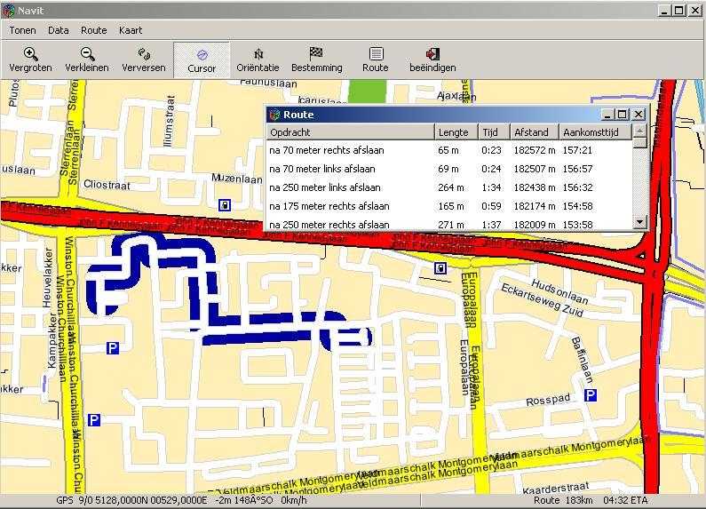

.. _platform_windows:

Windows
=======

   Navit under Windows, GTK GUI, Dutch translation

Download the binary distribution package of Navit
-------------------------------------------------

The Win32 binary distribution of Navit can be downloaded from the
`Navit download center <https://download.navit-project.org/>`__.

If the created start menu entry does not work, check if a 'bin' is too
many in the link target location.

Tips and Tricks
---------------

.. warning::

   The [[Win32 GUI]] build is broken, so use [[Gui internal]] instead!

Compiling, configuring and running Navit on Windows can be a challenge
at times. Below are a few hints, in addition to the more detailed
instructions following.

-  Support for NMEA serial GPS receiver devices (USB/Bluetooth) was
   broken in the win32 port since Navit releases 0.1.0. It is restored
   with the latest builds (3650 and higher). The configuration for serial
   devices has changed: For example, a serial device on Com4 can be
   configured as follows:

.. code:: xml

     <vehicle name="GPSOnCom4" enabled="yes" active="1" source="serial:COM4 baud=115200 parity=N data=8 stop=1" />

See also
--------

-  :doc:`/development/targets/windows_development`
